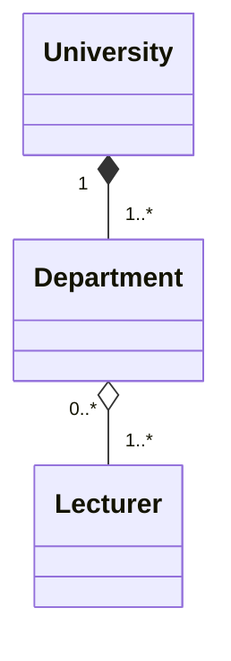

## Exercise 2 — University Departments

A university is made up of several departments — Computer Science, Business, and Design. Each department belongs to one university. If the university closes, its departments cease to exist with it.

Each department has a number of lecturers. A lecturer can teach across more than one department and may move between departments at the end of the year. If a department is dissolved, its lecturers do not disappear — they can be reassigned elsewhere in the university.

What is the relationship between `University` and `Department`? What is the relationship between `Department` and `Lecturer`? Draw a class diagram with the correct arrow types and multiplicity on both ends.

****## Explanation of relationships:
### 1. University and Department- Composition
The relationship between **University** and **Department** is **composition (◆)** because departments depend on the university for their existence.
- **1:** Each department belongs to exactly one university.
- **1..*** : A university has one or more departments.
 
If the university closes , its departments also cease to exist.****

### 2. Department and Lecturer- Aggregation
The relationship between **Department** and **Lecturer** is **aggregation (◇)** because lecturers can exist independently of a particular department. 
- **0..*** : A lecturer can have zero or many departments.
- **1..*** : A department has one or more lecturers.

A lecturer can teach in multiple departments. If a department closes, the lecturers still exist.
