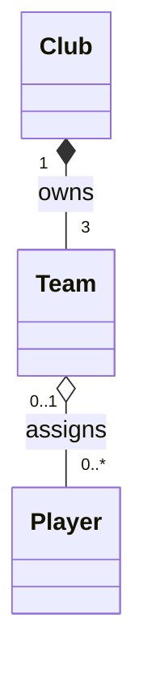

## Exercise 3 — Sports Club

A football club runs three teams: a first team, a reserve team, and a youth team. Each team belongs to the club — the First Team of Malmö FF has no meaning outside of Malmö FF. If the club shuts down, its teams cease to exist.

Players are assigned to a team. A player can be transferred to another club or loaned to a different team. If a team is disbanded, the players still exist — they remain registered with the club and can be reassigned.

What is the relationship between `Club` and `Team`? What is the relationship between `Team` and `Player`? Draw a class diagram with the correct arrow types and multiplicity on both ends.

## Explanation of relationships:
### 1. Club and Team - Composition
The relationship between **Club** and **Team** is **composition (◆)** because teams depend on the club for their existence.
- **1:** Each team belongs to exactly one club.
- **3:**  A club has exactly three teams.(First team, reserve team and youth team)

If the club closes , its teams cease to exist.

### 2. Team and Player- Aggregation
The relationship between **Team** and **Player** is **aggregation (◇)** because players can exist independently of a particular team.
- **0..1:** A player can belong to zero or one team at a time.
- **0..*** : A team can have zero or more players.

If a team is dissolved, the players still exist and can be reassigned.