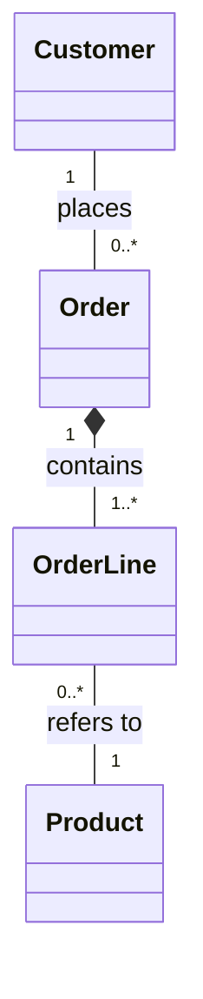

When a customer places an order in an online shop, the order is made up of order lines — one line per product, recording what was ordered and how many units. If the order is cancelled and deleted, its order lines have no meaning and are removed with it.

The products in the catalog exist on their own. They were there before any order was placed and remain after orders are completed or cancelled.

What is the relationship between Order and OrderLine? What is the relationship between OrderLine and Product? What is the relationship between Customer and Order? Draw a class diagram with the correct arrow types and multiplicity on both ends.

## Explanation of Relationships

### 1. Customer and Order — Association

The relationship between **Customer** and **Order** is association (—) because a customer places orders, but orders are not necessarily deleted when the customer is removed.

- **1:** Each order belongs to exactly one customer.
- **0..\*:** A customer can place zero or more orders.

### 2. Order and OrderLine — Composition

The relationship between **Order** and **OrderLine** is composition (◆) because order lines depend on the order for their existence.

- **1:** Each order line belongs to exactly one order.
- **1..\*:** An order contains one or more order lines.

If an order is deleted, its order lines are also deleted.

### 3. OrderLine and Product — Association

The relationship between **OrderLine** and **Product** is association (—) because an order line references a product but does not own it.

- **1:** Each order line references exactly one product.
- **0..\*:** A product can appear in zero or more order lines.

If an order is deleted, the products remain available in the product catalog.